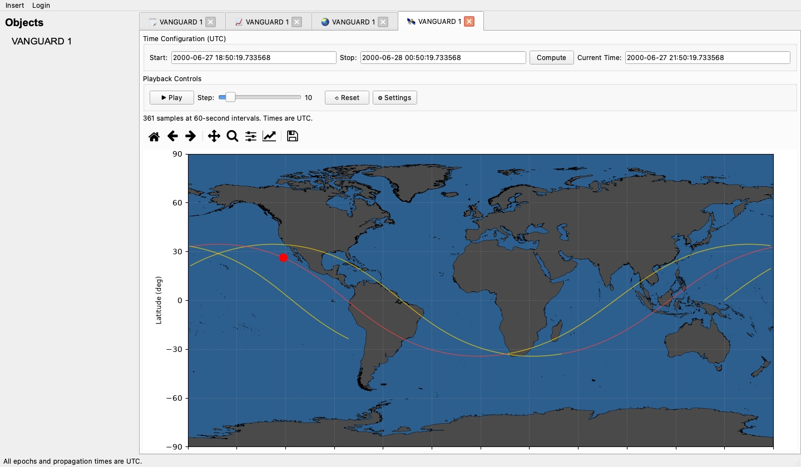
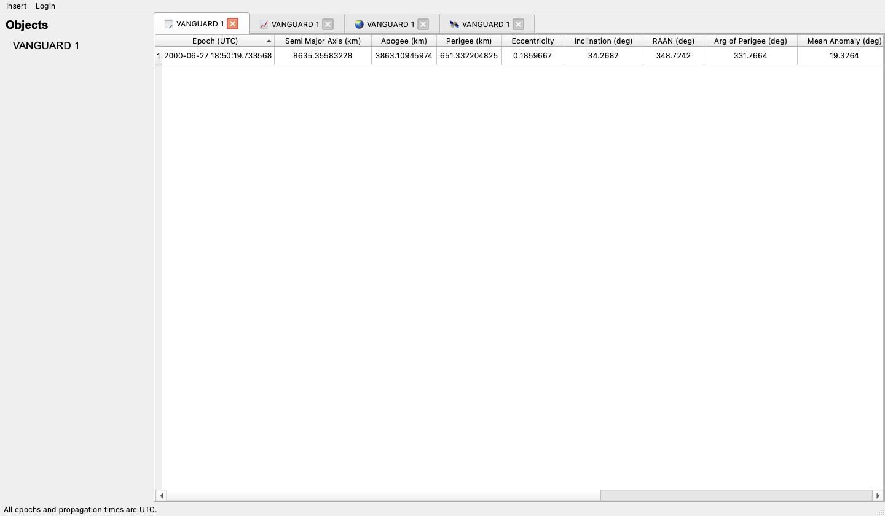
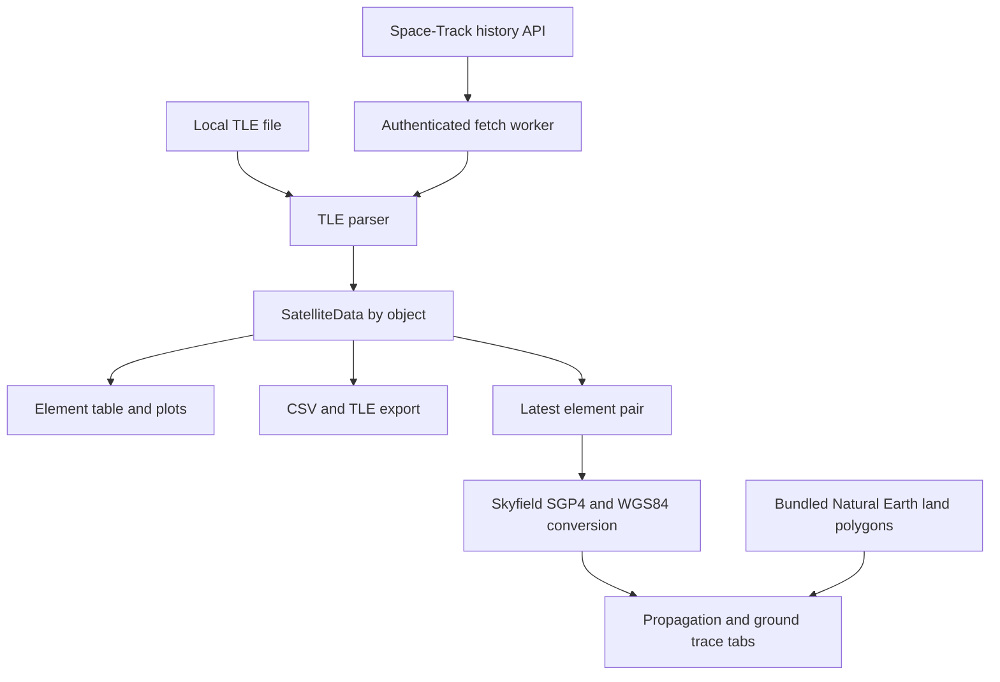

<p align="center"></p>
<h1 align="center">ORBIT</h1>
<p align="center">Orbital Retrieval and Behaviour Inspection Tool</p>

ORBIT is a desktop application for inspecting satellite two-line element sets (TLEs). Open a catalog history, compare orbital elements across epochs, then propagate the latest element pair to see its ground track.



Vanguard 1, catalog number 5. The ground trace contains 361 one-minute samples. The red marker shows the midpoint of the selected UTC interval.

## From element history to ground track

Each TLE describes an orbit at a particular epoch. ORBIT keeps the original line pair alongside each parsed row, so the historical measurements, exported records, and element pair selected for propagation can be traced back to the same input.

| View | Operation |
| --- | --- |
| Table | Sort epochs and inspect inclination, eccentricity, mean motion, BSTAR, and derived apogee and perigee. |
| Plot | Compare element values across epochs and open individual plots for closer inspection. |
| Propagate | Sample a trajectory from the latest imported epoch to an absolute stop time or a relative duration. |
| Ground Trace | Set both ends of a UTC interval, color segments around its midpoint, and play back the satellite position. |



## Run locally

Prerequisites are Conda, Git, and a graphical desktop. The application was exercised with Python 3.12.14 and the direct dependency versions in [environment.yml](environment.yml).

```sh
git clone https://github.com/surtecha/ORBIT.git
cd ORBIT
conda env create -f environment.yml
conda activate orbit-app
python main.py
```

Local file import, analysis, and the bundled land map require no account or environment variables.

### Reproduce the preview

Save the following historical SGP4 verification record as `vanguard.tle`. Keep both numbered lines intact.

```text
0 VANGUARD 1
1 00005U 58002B   00179.78495062  .00000023  00000-0  28098-4 0  4753
2 00005  34.2682 348.7242 1859667 331.7664  19.3264 10.82419157413667
```

1. Choose **Insert > Insert Local TLE** and open the file. Right-click **VANGUARD 1** in the Objects sidebar and choose **Table**.
2. Right-click the object again and choose **Ground Trace**. Keep the start at the imported epoch. Set the stop to `2000-06-28 00:50:19.733568` and select **Compute**.
3. Select **Play** to follow the marker along the ground track. **Settings** controls segment intervals, colors, and visibility.
4. Use **Export as CSV** in the object menu for parsed measurements or **Export as TLE** for the original numbered lines.

### Optional Space-Track retrieval

Use **Login > Login to Space-Track** with an authorized account, then choose **Insert > Insert from SpaceTrack**. Enter up to 100 NORAD catalog numbers, select publication date or TLE epoch, and specify an inclusive UTC date range. Completed historical queries can be reused from the local application cache.

Passwords remain in process memory unless persistence is selected and a supported operating-system credential store is available through the optional Python package `keyring`. No credentials belong in the source tree.

## Architecture



- **Import integrity.** The parser checks line length, checksum, catalog identifiers, and numeric fields. It groups pairs by catalog number, removes exact duplicates, and sorts each object's rows and source pairs together by UTC epoch.
- **Trajectory continuity.** Skyfield evaluates positions in batches and converts them to WGS84 latitude, longitude, and altitude. Sample indices survive filtering so the display can break the trace across failed samples and the longitude wrap.
- **Desktop state.** PySide6 signals connect controllers to tabs. Imports and calculations run in cancellable Qt workers. Closing a satellite's tabs releases view resources. Each imported object has an internal identifier independent of its display name.

| Component | Implementation |
| --- | --- |
| Desktop and charts | PySide6, Matplotlib |
| Element parsing and time series | sgp4, pandas, NumPy |
| Geographic trajectory and map | Skyfield, GeoPandas, bundled Natural Earth shapefile |
| Remote retrieval | Requests, Space-Track GP history API |

## Verification and limits

```sh
conda activate orbit-app
python -m unittest discover -s tests -v
```

Six regression tests cover checksum rejection, duplicate pair alignment, UTC sampling bounds, and three Space-Track session responses. The desktop workflow was also exercised offscreen through local import, all four views, trajectory computation, CSV and TLE export, rename, and deletion. Space-Track response tests use mock data. Live account access was not verified.

Propagation uses the latest imported pair for the entire selected interval. Historical rows remain available for inspection. The displayed path is a model prediction. The interface samples once per minute, caps a calculation at 100,000 samples, and reports omitted samples. Imported objects are held in memory for the session.

## Repository structure

| Path | Contents |
| --- | --- |
| `main.py`, `app/` | Qt entry point, controller construction, and signal connections |
| `backend/tle/`, `backend/propagator/` | Import, remote retrieval, time grids, and coordinate conversion |
| `backend/controllers/`, `backend/utils/` | Application operations, workers, authentication, and map loading |
| `data/`, `ui/` | Satellite records, desktop shell, dialogs, and analysis tabs |
| `assets/`, `docs/images/` | Application icon, Natural Earth land data, and captured interface views |
| `tests/` | Offline regression suite |
